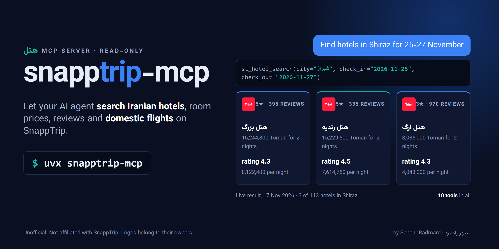

<!-- mcp-name: io.github.sepehr071/snapptrip-mcp -->

<div align="center">



# snapptrip-mcp: SnappTrip (اسنپ‌تریپ) hotels and flights MCP server for AI agents

**snapptrip-mcp is an unofficial, read-only MCP server that lets an AI agent search hotels, room prices, guest reviews and domestic flights on SnappTrip (اسنپ‌تریپ, snapptrip.com), the Snapp group's travel site.**<br>
Its 10 tools search Iranian hotels by city, dates, stars, price and facilities, read hotel details, rooms, nightly price calendars and guest reviews, and search domestic flights with a cheapest-days calendar.<br>
No API key or account is needed; it works in Claude, Cursor, Copilot and any other MCP client. It cannot book, reserve or pay.

[](https://pypi.org/project/snapptrip-mcp/)
[](https://pypi.org/project/snapptrip-mcp/)
[](https://github.com/sepehr071/snapptrip-mcp/actions/workflows/ci.yml)
[](https://github.com/sepehr071/snapptrip-mcp/blob/main/LICENSE)

[For AI agents](#for-ai-agents) · [Quick start](#quick-start) · [Tools](#tools) · [Limits](#limits) · [فارسی](#فارسی)

</div>

---

## For AI agents

- **What:** unofficial MCP server (model context protocol) for snapptrip.com: Iranian hotel search, rooms, nightly prices, reviews and domestic one-way flights.
- **Install:** `uvx snapptrip-mcp` or `claude mcp add snapptrip -- uvx snapptrip-mcp`. Transport: stdio. Needs [uv](https://docs.astral.sh/uv/getting-started/installation/) (Python 3.10+).
- **Auth:** none. Optional `SNAPPTRIP_MCP_PROXY` (HTTP proxy URL, or a comma-separated list); system proxy settings are ignored.
- **Access:** read-only, no confirmation needed. It cannot log in, book or pay.
- **Tools:** 10, all prefixed `st_`. Typical sequences: `st_hotel_places` -> `st_hotel_search` -> `st_hotel_detail` / `st_hotel_reviews` / `st_hotel_rooms` -> `st_hotel_calendar`; `st_hotel_filters` for facility ids; `st_flight_airports` -> `st_flight_prices` -> `st_flight_search`.
- **Use when:** the user wants hotels in an Iranian city for dates, what a room costs, what guests say about a hotel, or the cheapest day to fly between two Iranian cities.
- **Output:** compact JSON, Gregorian dates (YYYY-MM-DD), Toman. Hotel search and room prices are for the whole stay, the calendar per night, flights for the whole party.

## Quick start

You need [uv](https://docs.astral.sh/uv/getting-started/installation/). No API key or account.

Claude Code:

```bash
claude mcp add snapptrip -- uvx snapptrip-mcp
```

Claude Desktop, Cursor, VS Code and other clients:

```json
{
  "mcpServers": {
    "snapptrip": { "command": "uvx", "args": ["snapptrip-mcp"] }
  }
}
```

Example prompts:

- "Find 4 and 5 star hotels in Shiraz for 25 to 27 November under 10 million Toman."
- "What is the cheapest day to fly from Tehran to Mashhad this month?"
- "What do guests say about Park Saadi hotel in Shiraz?"
- <span dir="rtl">هتل‌های شیراز برای ۴ تا ۶ آذر را با قیمت کل اقامت نشان بده.</span>
- <span dir="rtl">ارزان‌ترین روز پرواز تهران به مشهد کدام است؟</span>

Real result (17 Nov 2026), `st_hotel_search(city="شیراز", check_in="2026-11-25", check_out="2026-11-27")` found 113 hotels; the first three: Bozorg 5 stars, rating 4.3 (395 reviews), 16,244,800 Toman for 2 nights; Zandiyeh 5 stars, 4.5 (335), 15,229,500; Arg 3 stars, 4.3 (970), 8,086,000.

## Tools

| Tool | What it does |
|---|---|
| `st_hotel_places` | Find a SnappTrip hotel city or a hotel by name. |
| `st_hotel_search` | Search hotels in a city for dates with star, price and facility filters. |
| `st_hotel_filters` | List the filters a city offers for dates: facilities (ids), categories, accommodation types, price range, stars. |
| `st_hotel_detail` | Get a hotel's description, location, facilities, policies, photos and guest rating breakdown. |
| `st_hotel_rooms` | List the rooms of a hotel with prices for the dates. |
| `st_hotel_calendar` | Show a room's per-night price and rooms left for each day, with the cheapest bookable nights. |
| `st_hotel_reviews` | Read guest reviews of a hotel, newest first, with pros, cons and the room stayed in. |
| `st_flight_airports` | List the cities SnappTrip offers flights from, with IATA codes and airports. |
| `st_flight_search` | Search one-way domestic economy flights for a date, cheapest first. |
| `st_flight_prices` | Show the lowest one-way price per day for the next weeks and the cheapest days. |

## Limits

- Hotel search and room prices are whole-stay Toman; the calendar is per night; flight prices are converted from Rial to Toman.
- The flight price calendar accepts only today's date as its start. Flights are one-way, economy, domestic.
- Not covered: trains, buses, villas, international hotels and flights, booking, login.
- The 10 tools were mapped from SnappTrip's JavaScript bundles; the hotel tools were checked against the real pages in Chrome (2026-11-16). The flight tools were checked by the owner earlier, not re-checked in Chrome. Request headers were not compared with a browser capture.
- Prices and availability change by the minute; answers are cached for 60 seconds.

## فارسی

<div dir="rtl">

snapptrip-mcp یک سرور MCP غیررسمی و فقط‌خواندنی است که به عامل هوش مصنوعی اجازه می‌دهد در اسنپ‌تریپ هتل‌های ایران، اتاق‌ها، قیمت هر شب، نظر مهمان‌ها و پروازهای داخلی را جست‌وجو کند. کلید API یا حساب کاربری لازم نیست و رزرو یا پرداخت انجام نمی‌دهد. نصب در Claude Code:

</div>

```bash
claude mcp add snapptrip -- uvx snapptrip-mcp
```

## Development

```bash
uv sync
uv run ruff check . && uv run ruff format --check .
uv run pytest -q          # offline tests on recorded fixtures
uv run pytest -m live -q  # live calls to SnappTrip
```

Releases: bump the version in `pyproject.toml` and `server.json`, run `uv lock`, then push a `v*` tag; GitHub Actions publishes to PyPI.

## Disclaimer

Unofficial and not affiliated with or endorsed by SnappTrip or the Snapp group. It is read-only and uses the public endpoints of the site, which can change without notice.

## Author

Built and maintained by **Sepehr Radmard** (سپهر رادمرد). [LinkedIn](https://www.linkedin.com/in/sepehr-radmard) · [GitHub](https://github.com/sepehr071) · more servers in [iran-mcp](https://github.com/sepehr071/iran-mcp).

## مجوز استفاده (License)

<a href="https://www.linkedin.com/in/sepehr-radmard"></a>

**استفادهٔ شخصی و غیرتجاری رایگان است.** استفاده در شرکت، محصول پولی یا پروژهٔ مشتری به مجوز تجاری نیاز دارد؛ از راه [لینکدین](https://www.linkedin.com/in/sepehr-radmard) یا [گیت&zwnj;هاب](https://github.com/sepehr071) با سپهر رادمرد تماس بگیرید. متن کامل: [PolyForm Noncommercial 1.0.0](https://github.com/sepehr071/snapptrip-mcp/blob/main/LICENSE). نسخه&zwnj;های پیش از 0.1.1 با مجوز MIT منتشر شده&zwnj;اند و همان مجوز را دارند.

Free for personal and non-commercial use under the [PolyForm Noncommercial License 1.0.0](https://github.com/sepehr071/snapptrip-mcp/blob/main/LICENSE). Using it in a company, a paid product or a client project needs a commercial license: contact Sepehr Radmard on [LinkedIn](https://www.linkedin.com/in/sepehr-radmard) or [GitHub](https://github.com/sepehr071). Versions before 0.1.1 were released under MIT and stay under it.
